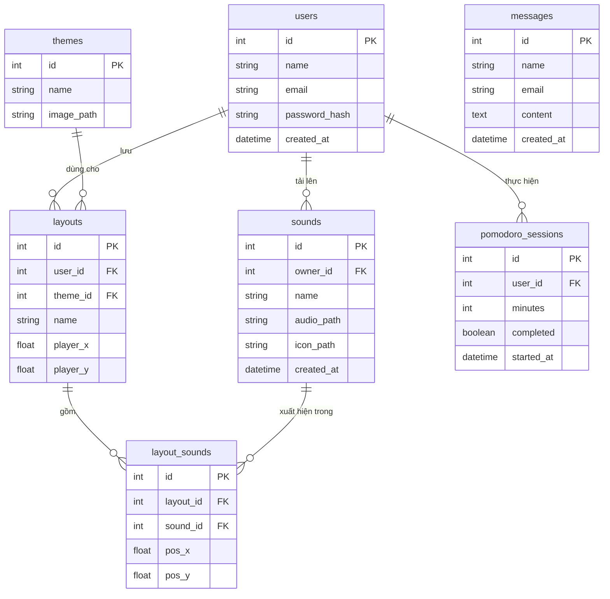

# FocusSpace

> Không gian âm thanh cá nhân hóa cho học tập và làm việc tập trung.

FocusSpace là web sandbox kết hợp white noise và âm thanh môi trường. Thay vì nghe một playlist cố định, người dùng tự chọn, kết hợp và sắp xếp các nguồn âm trong một không gian 2D. Kéo một nguồn âm lại gần nhân vật thì âm lượng tăng, kéo ra xa thì âm lượng giảm.

Dự án thuộc môn **Web Basic Design and Development (CSB25022) – VNUK**.

- **Repo:** `<dán link GitHub>`
- **Demo:** `<dán link triển khai, nếu có>`
- **Video demo:** `<dán link video>`

---

## Mục lục

1. [Tổng quan](#tổng-quan)
2. [Công nghệ sử dụng](#công-nghệ-sử-dụng)
3. [Cách chạy dự án](#cách-chạy-dự-án)
4. [Tính năng](#tính-năng)
5. [Cấu trúc thư mục](#cấu-trúc-thư-mục)
6. [Cơ sở dữ liệu (ERD)](#cơ-sở-dữ-liệu-erd)
7. [Phân công thành viên](#phân-công-thành-viên)
8. [Quy ước làm việc](#quy-ước-làm-việc)
9. [Thông tin bổ sung](#thông-tin-bổ-sung)

---

## Tổng quan

**Vấn đề:** Tiếng ồn, thông báo và mạng xã hội làm gián đoạn sự tập trung. Các playlist cố định còn hạn chế khả năng tùy chỉnh âm thanh.

**Giải pháp:** Người dùng tự chọn, kết hợp và sắp xếp các nguồn âm để tạo môi trường phù hợp với mình.

**Người dùng mục tiêu:**

- Sinh viên: học tập, làm bài.
- Người thích âm thanh môi trường: thư giãn.

---

## Công nghệ sử dụng

| Nhóm | Công nghệ |
|---|---|
| Framework | Next.js 16 (App Router), React, TypeScript |
| Giao diện | Tailwind CSS v4 (cấu hình trong `app/globals.css`) |
| Font | Be Vietnam Pro (qua `next/font/google`) |
| Âm thanh | Web Audio / `HTMLAudioElement`, phát lặp nhiều nguồn |
| Lưu trữ tạm | `localStorage` (vị trí, theme, bố cục) |
| Backend *(dự kiến)* | Route Handlers của Next.js, Node.js |
| Cơ sở dữ liệu *(dự kiến)* | MySQL |
| Công cụ | Git và GitHub, ESLint, Figma, Lighthouse |

---

## Cách chạy dự án

**Yêu cầu:** Node.js 20.9 trở lên, npm.

```bash
# 1. Lấy mã nguồn
git clone <link-repo>
cd focuspace

# 2. Cài thư viện
npm install

# 3. Chạy chế độ phát triển
npm run dev
```

Mở [http://localhost:3000](http://localhost:3000) trên trình duyệt.

Các lệnh khác:

```bash
npm run build   # build bản production
npm run start   # chạy bản đã build
npm run lint    # kiểm tra lỗi code
```

> Khi có phần cơ sở dữ liệu, bổ sung ở đây: tạo file `.env.local`, chạy migration và seeder.

---

## Tính năng

### Đã có

| Trang | Đường dẫn | Mô tả |
|---|---|---|
| Trang chủ | `/` | Giới thiệu, 3 bước cách dùng, nút vào Workspace |
| Workspace | `/workspace` | Không gian chính để kéo thả và nghe |

**Workspace:**

- Kéo thả nguồn âm và nhân vật bằng chuột hoặc cảm ứng; dùng phím mũi tên để di chuyển khi đang chọn.
- Âm lượng đổi theo khoảng cách tới nhân vật. Viền nút cho biết vùng Gần, Trung bình, Xa.
- Thư viện âm thanh: bật hoặc tắt các nguồn Mưa đêm, Lửa trại, Quán cà phê, Sóng biển, Gió nhẹ.
- Background theme: Đêm tuyết, Sương lam, Bình minh.
- Thư viện bố cục: 3 bố cục có sẵn (Tập trung sâu, Buổi sáng dịu, Tối ấm áp) và lưu bố cục cá nhân.
- Pomodoro: đồng hồ Tập trung và Nghỉ ngơi, tùy chỉnh thời gian, đếm số phiên hoàn thành.
- Tự lưu trạng thái trong trình duyệt.

### Đang phát triển

- Đăng nhập, đăng ký.
- Thêm âm thanh riêng: tải file MP3 (tối đa 20 MB), tải ảnh hoặc tự vẽ biểu tượng.
- Lưu dữ liệu vào cơ sở dữ liệu, trang Giới thiệu và liên hệ, trang lỗi 404.

### Ảnh chụp màn hình

| Workspace | Thư viện âm thanh |
|---|---|
| `` | `` |

| Theme | Bố cục | Pomodoro |
|---|---|---|
| `` | `` | `` |

> Thay các dòng trên bằng ảnh thật, đặt trong `docs/screenshots/`.

---

## Cấu trúc thư mục

```
focuspace/
├─ app/
│  ├─ layout.tsx               # layout gốc, font Be Vietnam Pro
│  ├─ globals.css              # cấu hình Tailwind (màu, font)
│  ├─ (site)/                  # trang có header và footer
│  │  ├─ layout.tsx
│  │  └─ page.tsx              # Trang chủ
│  └─ (app)/
│     └─ workspace/page.tsx    # Workspace toàn màn hình
├─ components/
│  ├─ Header.tsx
│  ├─ Footer.tsx
│  └─ workspace/               # các thành phần của Workspace
├─ public/
│  ├─ audio/                   # file âm thanh
│  └─ themes/                  # ảnh nền
└─ docs/                       # wireframe, ERD, ảnh chụp màn hình
```

---

## Cơ sở dữ liệu (ERD)

> Bản nháp, sẽ cập nhật khi hoàn thành phần backend.



---

## Phân công thành viên

| Thành viên | Phần phụ trách |
|---|---|
| Đậu Tuấn Lộc | `<điền>` |
| `<Thành viên 2>` | `<điền>` |
| `<Thành viên 3>` | `<điền>` |
| `<Thành viên 4>` | `<điền>` |

---

## Quy ước làm việc

- Nhánh theo tính năng: `feat/<khu-vực>-<việc>`. Không commit thẳng vào `main`.
- Commit theo Conventional Commits, ví dụ `feat(workspace): add Pomodoro timer panel`.
- Mỗi Pull Request ghi `Closes #<số issue>` và được một thành viên khác duyệt trước khi gộp.

---

## Thông tin bổ sung

### Nguồn âm thanh và hình ảnh

| File | Nguồn | Giấy phép |
|---|---|---|
| `rain.mp3` | `<link>` | `<CC0 / khác>` |
| `campfire.mp3` | `<link>` | `<...>` |
| `cafe.mp3` | `<link>` | `<...>` |
| `waves.mp3` | `<link>` | `<...>` |
| `wind.mp3` | `<link>` | `<...>` |

### Kiểm tra hiệu năng (Lighthouse)

| Trang | Performance | Accessibility | Best Practices | SEO |
|---|---|---|---|---|
| `/` | | | | |
| `/workspace` | | | | |

### Hạn chế đã biết

- Trình duyệt chỉ cho phát âm thanh sau khi người dùng chạm hoặc bấm vào trang một lần.
- Dữ liệu hiện lưu trong trình duyệt, chưa đồng bộ giữa các thiết bị.
